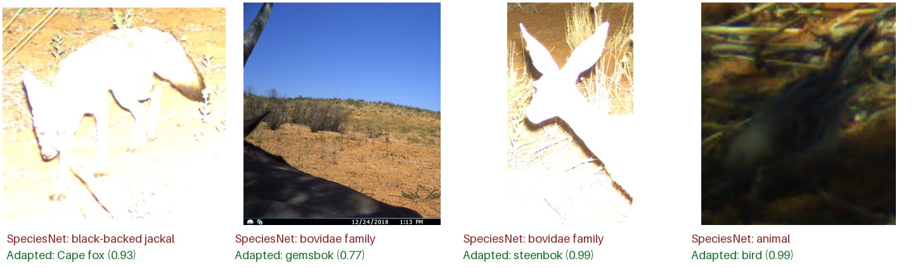

# Case study: adapting SpeciesNet to the Kgalagadi

How well does a global camera-trap classifier work in one park, and how much does a
small regional adaptation help? This case study runs CamTrapTools on all animal images
from Snapshot Kgalagadi Season 1 and measures SpeciesNet before and after adapting it,
on cameras that were never used for training.

## Summary

- On 7 held-out cameras, adapting SpeciesNet with `adapt` and using it in `detect`
  raised **correct independent events from 72 to 92 of 104** (69% to 88%) and lowered
  wrong events from 16 to 9.
- The gain came mostly from **night images**: correct night events rose from 27 to 40
  of 45, against 45 to 52 of 59 by day. Overexposed infrared photos are where SpeciesNet
  was weakest.
- On the held-out cameras, every one of the 78 detections whose label changed had been
  either wrong or only identified to a higher taxon; **none went from right to wrong**.
- Half of the improvement needs no training: **limiting SpeciesNet to the species in the
  training data** already raised the share of crops named correctly from 72% to 85%.
  Training the new layer raised it to 91%.
- SpeciesNet's misses were mostly cautious answers (*Bovidae*, "animal") rather than
  wrong species. The adapted layer always names a species, so `detect` only uses it
  above a confidence threshold, chosen on validation cameras so that it is as precise as
  SpeciesNet.
- The whole run took about 45 minutes on a laptop (Apple M4): 22 minutes for
  SpeciesNet, 17 for crop features, seconds for training and 5 for `detect --adapted`.



*Detections from held-out cameras: an overexposed Cape fox that SpeciesNet called a
black-backed jackal, a close-up gemsbok and an infrared steenbok it left at Bovidae,
and a bird in the dark it left as "animal".*

## Data

[Snapshot Kgalagadi](https://lila.science/datasets/snapshot-kgalagadi/) Season 1 (LILA
BC, CDLA-Permissive): 20 cameras in the Kgalagadi Transfrontier Park, South Africa,
October 2018 to January 2019, with labels from Snapshot Safari's volunteer consensus.
The study uses the 2,336 images with animals; blank images and images of people are left
out, so false detections on empty images are not measured here.

| | |
|---|---|
| Images | 2,336, from 20 cameras |
| Independent events (30-minute rule) | 466 |
| Labelled animal crops | 2,853 |
| Labelled taxa | 28, from 1,378 gemsbok images to single images of lion and aardvark |

The crops were split by camera, so no camera's background is seen in more than one
split:

| Split | Cameras | Crops | Events |
|---|---|---|---|
| Train | A01, A03, A06, A08, B01, B03, B07, B09 | 1,997 | 249 |
| Validation | A02, A04, A10, A11, B02 | 425 | 102 |
| Test | A05, A07, A09, B04, B05, B06, B08 | 431 | 99 |

## Method

1. `detect --country ZAF` ran SpeciesNet 4.0.3a on every image, and `events` grouped
   the images into independent events.
2. `crops` cut every labelled animal detection into a crop, with 10% padding.
3. `adapt` kept SpeciesNet's EfficientNetV2-M backbone frozen and trained a new final
   layer for the 22 labels in the training crops, starting from SpeciesNet's own weights
   for each of them. Training used cross-entropy with every crop weighted equally and
   kept the epoch with the lowest validation loss (epoch 29).
4. `adapt` chose a confidence threshold on the validation cameras: the lowest at which
   the adapted layer's answers are at least as precise as SpeciesNet's species-level
   answers on the same crops (97%). This gave **0.69**.
5. `detect --adapted` used the adapted answer for every animal detection at or above
   0.69, unless SpeciesNet had named a species that the layer was not trained on (such
   as leopard). `events` and `evaluate --deployment` then scored the test cameras.

Settings were chosen on the validation cameras only; the test cameras were used once,
for the results below.

## Results

### Crops named correctly

Among test crops whose label was in the training data (418 of 431):

| Approach | Train | Validation | Test |
|---|---|---|---|
| SpeciesNet, as run by `detect` | 78% | 79% | 72% |
| SpeciesNet limited to the 22 training labels | 91% | 89% | 85% |
| Adapted layer | 94% | 94% | **91%** |

Per label on the test cameras:

| Label | Crops | SpeciesNet | Limited to labels | Adapted |
|---|---|---|---|---|
| *Oryx gazella* (gemsbok) | 258 | 0.77 | 0.88 | 0.97 |
| *Tragelaphus oryx* (eland) | 58 | 0.69 | 0.81 | 0.76 |
| Aves (birds) | 28 | 0.86 | 1.00 | 1.00 |
| *Canis mesomelas* (black-backed jackal) | 18 | 0.78 | 1.00 | 0.94 |
| *Ardeotis kori* (kori bustard) | 9 | 1.00 | 1.00 | 1.00 |
| *Vulpes chama* (Cape fox) | 8 | 0.00 | 0.00 | 1.00 |
| *Alcelaphus buselaphus* (hartebeest) | 7 | 0.57 | 0.86 | 0.43 |
| *Connochaetes taurinus* (blue wildebeest) | 7 | 0.57 | 1.00 | 1.00 |
| *Raphicerus campestris* (steenbok) | 7 | 0.57 | 1.00 | 1.00 |
| Six labels with 3 crops each | 18 | 0.11 | 0.28 | 0.39 |
| **Average over labels** | 418 | 0.43 | 0.61 | 0.70 |

The Cape fox shows what training adds: SpeciesNet called all eight test crops a
black-backed jackal, even when limited to local labels, but after training on only
three Cape fox crops the adapted layer named all eight. Eland and hartebeest got worse
than with the label list alone, as the layer learned to favour the much more common
gemsbok.

### Mistakes and the threshold

Of SpeciesNet's 118 test misses, 112 were cautious answers such as *Bovidae* (43),
"animal" (31) or "unknown" (9); only 6 named the wrong species. The adapted layer
always names a species, so all 37 of its misses are wrong species. The threshold
manages this trade-off:

| Test crops | Answers to species | Right | Wrong |
|---|---|---|---|
| SpeciesNet | 282 | 276 | 6 |
| Adapted layer at 0.69 or higher | 364 | 352 | 12 |

Below the threshold, `detect` keeps SpeciesNet's answer.

### Independent events

`evaluate --deployment` on the 104 test-camera events, with the volunteer labels as
truth:

| Outcome | SpeciesNet | With adapted layer |
|---|---|---|
| Correct | 72 (69%) | **92 (88%)** |
| Correct only to a higher taxon | 16 (15%) | 3 (3%) |
| Wrong | 16 (15%) | 9 (9%) |

| Correct events | SpeciesNet | With adapted layer |
|---|---|---|
| Day (06:00 to 19:00), 59 events | 45 | 52 |
| Night, 45 events | 27 | **40** |

Event-level mistakes fell even though crop-level wrong answers rose, because an event's
label is a vote across its images: a few confident wrong crops rarely outvote the rest.

### What still goes wrong

Of the 9 wrong test events after adaptation:

- 5 are small birds or a rodent that the detector did not find, so the event is blank.
  The classifier never sees them.
- 2 are a meerkat and a caracal that neither model could identify; meerkats were not in
  the training data.
- 1 is a grey duiker called a steenbok and 1 is an African wildcat called a black-backed
  jackal. Both species had fewer than ten training crops.

On training camera A06, three blue wildebeest detections were changed to gemsbok. These
are not part of the test results, but they show the layer's pull towards the most
common species.

## Limitations

- **Small test counts for rare species.** Several species have three test crops or
  fewer, so their per-label figures are anecdotes, not estimates.
- **Correlated samples.** The 418 test crops come from 95 events; images of one visit are
  not independent, so the crop-level figures overstate the effective sample size.
- **One season, one park.** The layer was trained and tested on the same season; its
  value on later seasons or nearby parks is not measured.
- **Volunteer labels.** Snapshot Safari labels are a consensus of volunteers, not expert
  verification, and each image has one label even when two species appear in it.
- **No empty images.** Blank images were excluded, so the false positive rate on empty
  images is unknown.
- **Unseen species.** Five species appear only in validation or test cameras (meerkat,
  leopard, cheetah, bat-eared fox, spotted hyena). The adapted layer cannot name them;
  `detect` keeps SpeciesNet's answer when SpeciesNet names them.

## Reproduce

Requires the `detect` extra and about 3 GB of disk space.

```bash
uv run python examples/kgalagadi/prepare.py kgalagadi
uv run camtraptools ingest kgalagadi/sd_cards --out kgalagadi/package
uv run camtraptools detect kgalagadi/package --images kgalagadi/sd_cards --country ZAF
uv run camtraptools events kgalagadi/package
uv run camtraptools crops kgalagadi/package --images kgalagadi/sd_cards \
    --out kgalagadi/crops --truth kgalagadi/truth.csv
uv run camtraptools adapt kgalagadi/crops --out kgalagadi/model
uv run camtraptools evaluate kgalagadi/package --truth kgalagadi/truth.csv \
    --deployment A05 --deployment A07 --deployment A09 --deployment B04 \
    --deployment B05 --deployment B06 --deployment B08
uv run camtraptools detect kgalagadi/package --images kgalagadi/sd_cards \
    --country ZAF --adapted kgalagadi/model
uv run camtraptools events kgalagadi/package
uv run camtraptools evaluate kgalagadi/package --truth kgalagadi/truth.csv \
    --deployment A05 --deployment A07 --deployment A09 --deployment B04 \
    --deployment B05 --deployment B06 --deployment B08
```

The first `evaluate` scores SpeciesNet alone, the second the adapted layer. Splits
depend on the number of crops per camera, so they match the ones above as long as the
same images and labels are used.

Data: Snapshot Kgalagadi, Snapshot Safari, published on LILA BC under the
[Community Data License Agreement (permissive)](https://cdla.io/permissive-1-0/).
