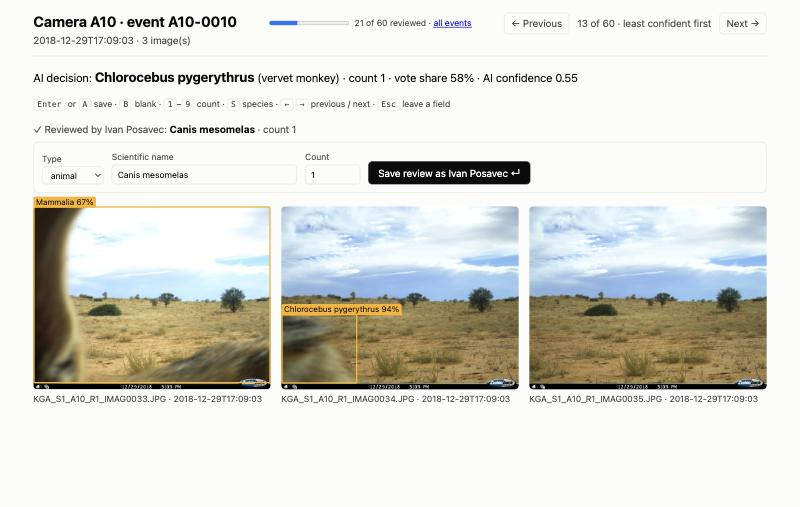

# CamTrapTools user guide

This guide takes a camera-trap survey from SD cards to ecological results and a
dataset ready for GBIF, one step at a time. Every command is shown with the output it
prints, using real images from
[Snapshot Kgalagadi](https://lila.science/datasets/snapshot-kgalagadi/).

You do not need to know Python. You need a terminal (Terminal on macOS, PowerShell on
Windows), your images, and about an hour for a first survey.

## Contents

1. [What CamTrapTools does](#1-what-camtraptools-does)
2. [Key ideas](#2-key-ideas)
3. [Install](#3-install)
4. [Prepare your images and field sheet](#4-prepare-your-images-and-field-sheet)
5. [Step 1: build the package (`ingest`)](#step-1-build-the-package-ingest)
6. [Step 2: check the cameras (`check`, `report`)](#step-2-check-the-cameras-check-report)
7. [Step 3: find and identify animals (`detect` or `import`)](#step-3-find-and-identify-animals-detect-or-import)
8. [Step 4: group images into visits (`events`)](#step-4-group-images-into-visits-events)
9. [Step 5: review the AI (`review`, `review-stats`)](#step-5-review-the-ai-review-review-stats)
10. [Step 6: measure the AI (`evaluate`, `labels`)](#step-6-measure-the-ai-evaluate-labels)
11. [Step 7: adapt the AI to your region (`crops`, `adapt`)](#step-7-adapt-the-ai-to-your-region-crops-adapt)
12. [Step 8: ecological results (`ecology`, `summary`, `compare`)](#step-8-ecological-results-ecology-summary-compare)
13. [Step 9: publish (`export`)](#step-9-publish-export)
14. [Choosing a workflow](#choosing-a-workflow)
15. [Files in a package](#files-in-a-package)
16. [Troubleshooting](#troubleshooting)
17. [Command reference](#command-reference)
18. [Try it on real data](#try-it-on-real-data)

---

## 1. What CamTrapTools does

```
SD cards ─► ingest ─► check / report ─► detect (or import) ─► events ─► review ─► ecology ─► export ─► GBIF
                                             ▲                            │
                                             └── evaluate / crops / adapt ┘
```

| Stage | Command | What you get |
|---|---|---|
| Organise | `ingest` | A standard data package listing every image (and video) and camera |
| Quality control | `check`, `report` | Dead batteries, fallen cameras, wrong clocks, broken flashes, as a list and a shareable HTML report |
| AI | `detect` or `import` | Animals, people and vehicles found and identified in every image |
| Visits | `events` | Images grouped into independent visits, with a species and count for each |
| Human check | `review`, `review-stats` | A browser app to confirm or correct the AI, least confident decisions first |
| Accuracy | `labels`, `evaluate` | Your existing labels imported; how often the AI is right per species, which confidence to trust, and a report of its mistakes |
| Regional AI | `crops`, `adapt` | A version of the AI fitted to your area's species and cameras |
| Ecology | `ecology`, `compare` | Relative abundance, occupancy (also with site covariates), daily activity and overlap, species richness, and how much AI mistakes change them |
| Results | `summary` | One HTML page of the results to hand back to a project |
| Publish | `export` | A validated Camtrap DP package for GBIF |

Everything runs on your own computer. Images never leave it, and the review app is
only reachable from the same machine.

## 2. Key ideas

**Deployment.** One camera at one place for one period, from setup to pickup. In
CamTrapTools each deployment is one folder of images. A **location** is the place; a
camera moved back to the same spot later is a second deployment at the same location.

**Camtrap DP package.** [Camtrap DP](https://camtrap-dp.tdwg.org) is the standard
format for camera-trap data, used by GBIF. A package is a folder of tables:
`deployments.csv` (cameras), `media.csv` (images) and `observations.csv` (what is in
the images). CamTrapTools builds and fills these tables step by step.

**Detection and classification.** The AI works in two stages. The **detector**
(MegaDetector) draws a box around every animal, person or vehicle. The
**classifier** (SpeciesNet) names the animal in each box. Both give a
**confidence** between 0 and 1. Confidence is not accuracy: a model can be 94% sure
and wrong.

**Higher taxon.** When SpeciesNet is unsure of the species it answers at a higher
level, such as *Bovidae* (the antelope family) or "animal". These answers are cautious,
not wrong.

**Event (independent visit).** A burst of images of the same animal is one visit, not
twenty. Images at a camera belong to the same event until there is a gap of more than
30 minutes. Ecological analyses count events, not images.

**Camera-day.** One camera running for one day: the unit of sampling effort. Twenty
cameras running for 30 days are 600 camera-days.

**Geofencing.** Telling SpeciesNet the country (`--country ZAF`) stops it from naming
species that do not live there.

**Occupancy.** The share of sites where a species lives. **Naive occupancy** is the
share of sites where it was recorded; it is too low for shy species, which are missed
where they live. The **occupancy model** corrects for this using how often the species
is recorded where it is known to be.

## 3. Install

CamTrapTools is on [PyPI](https://pypi.org/project/camtraptools/). The easiest way to
install it is with [uv](https://docs.astral.sh/uv/getting-started/installation/), a
small program that installs Python tools in their own environment. Install uv, then
open a new terminal and run:

```bash
uv tool install "camtraptools[detect]"
```

This installs everything, including SpeciesNet and PyTorch (about 1 GB). If you only
need quality checks, or you already have AI results from another tool, the smaller
install is enough:

```bash
uv tool install camtraptools
```

If you already use Python, `pip install "camtraptools[detect]"` works too, preferably
in a virtual environment.

Check that it works:

```bash
camtraptools --version
```

```
CamTrapTools 0.7.1
```

`camtraptools --help` lists all commands, and `camtraptools COMMAND --help` explains
one command and its options.

**Updating.** Run `uv tool upgrade camtraptools` (or `pip install --upgrade camtraptools`).

**Computer.** Any recent laptop works. SpeciesNet uses an NVIDIA graphics card or an
Apple Silicon Mac's GPU when there is one; on an Apple M4, 2,300 images take about 20
minutes. The first `detect` downloads the models (about 500 MB) once.

## 4. Prepare your images and field sheet

### Folder layout

Copy each SD card into its own folder, named after the deployment. Subfolders such as
`DCIM/100MEDIA` are fine; CamTrapTools searches each folder at any depth.

```
sd_cards/
├── camera_A/DCIM/100MEDIA/IMG_0001.JPG …
├── camera_B/DCIM/100MEDIA/IMG_0001.JPG …
└── camera_C/IMG_0001.JPG …
```

- JPEG images (`.jpg`, `.jpeg`) are read. Videos (`.mp4`, `.mov`, `.avi`) are read
  with `--videos` (see below); other files are skipped, and `ingest` says how many of
  each kind it skipped.
- Folder names become deployment IDs, so use short names without spaces, such as
  `A02` or `north_ridge_2024`.
- Keep the original files. CamTrapTools never changes or moves images; it only reads
  them.

If your cards are organised one level deeper, for example by site and then camera,
tell `ingest` which level holds one deployment each with `--folder-depth`:

```
sd_cards/
├── north/camera_A/…   →  deployment north_camera_A
└── south/camera_A/…   →  deployment south_camera_A
```

```bash
camtraptools ingest sd_cards --out my_survey --folder-depth 2
```

The deployment ID joins the folder names with `_`; use the same IDs in the field
sheet.

### Field sheet (recommended)

A field sheet is a CSV or Excel file with one row per deployment. It adds what images
cannot tell: where the camera was and when it really started and stopped.

| Column | Required | Example | Notes |
|---|---|---|---|
| `deploymentID` | yes | `camera_A` | Must match the folder name |
| `latitude`, `longitude` | yes | `-25.501`, `20.498` | Decimal degrees; needed for `export` |
| `deploymentStart` | recommended | `2024-05-01T09:15` | When the camera was set up |
| `deploymentEnd` | recommended | `2024-06-30T16:00` | When it was collected |
| `locationName`, `locationID` | optional | `North ridge` | Deployments with the same location are treated as one site |
| `cameraTime`, `actualTime` | optional | `2010-01-01T00:04`, `2024-05-01T09:19` | Corrects a wrong camera clock; see below |
| any other Camtrap DP column | optional | `cameraModel`, `cameraHeight`, `habitat`, `deploymentComments` | Kept in the package |

```csv
deploymentID,locationName,latitude,longitude,deploymentStart,deploymentEnd,cameraModel
camera_A,North ridge,-25.501,20.498,2024-05-01T09:15,2024-06-30T16:00,Browning BTC-8E
camera_B,Dry riverbed,-25.533,20.512,2024-05-01T11:40,2024-06-30T14:20,Browning BTC-8E
```

**Why the dates matter.** Without them, a deployment is assumed to last from its first
to its last image. That underestimates effort (on the Kgalagadi cameras by 10–16%) and
hides a camera that died early, because the silence after its last image is invisible.

**Time zones.** Write times as the camera clocks showed them (local time). You give
the time zone once, when you publish.

**Wrong camera clocks.** Cameras often lose their clock after a battery change and
restart at a date like 2010-01-01. To correct it, photograph a phone showing the time
with the camera (or note the camera's display), and fill in two columns: `cameraTime`,
the time the camera showed, and `actualTime`, the real time at that moment. `ingest`
shifts all of that deployment's images by the difference, keeps each image's original
camera time in `mediaComments`, and reports it:

```
Corrected the clock of cam_reset by +5173 days 8:00:00.
```

The correction applies to the whole deployment. If a clock was reset partway through,
put the images from before and after the reset in two folders (two deployments) and
correct only the second.

## Step 1: build the package (`ingest`)

```bash
camtraptools ingest sd_cards --out my_survey --field-sheet field_sheet.csv
```

```
Found 194 images from 4 deployments.
Wrote my_survey/media.csv and my_survey/deployments.csv
```

CamTrapTools reads the capture time of every image from its EXIF data and writes the
package to `my_survey/`. Use this folder in every later command.

If the field sheet has problems, `ingest` lists them, for example:

```
4 field-sheet issue(s):
  ! cam_healthy: listed more than once in the field sheet
  ! cam-reset: impossible coordinates (152.71, 23.86)
  ! cam_reset: has images but is not in the field sheet (did you mean 'cam-reset'?)
  ! cam_future: 5 image(s) taken after the recorded end
```

Fix the sheet and run `ingest` again; it overwrites the two tables and never touches
later results.

**Videos.** If your cameras record video, add `--videos`:

```bash
camtraptools ingest sd_cards --out my_survey --field-sheet field_sheet.csv --videos
```

```
Found 1 image and 2 videos from 1 deployment.
  1 video stores no recording time; the file date is used
```

The recording time is read from the video file, where trail cameras store it. When a
video has none, the file's date is used and noted in `mediaComments`; copy cards in a
way that keeps file dates. `detect` then samples one frame per second of each clip (at
most 10, set with `--frame-interval` and `--max-frames`), runs SpeciesNet on them, and
uses the frame with the most confident animal as the video's result. In the review
app, a video shows that frame with the AI's boxes and a player for the clip.

`ingest` also reports files it did not read, such as
`Skipped 118 files that are not JPEG images: .mp4 (118)`, and JPEG images that are not
inside a deployment folder, which usually means `--folder-depth` needs changing.

## Step 2: check the cameras (`check`, `report`)

```bash
camtraptools check my_survey
```

For healthy cameras:

```
A02: 46.7 days, 90 images, longest gap 18.9 days
  OK
A03: 46.0 days, 22 images, longest gap 18.3 days
  OK
```

For a survey with problems:

```
cam_future: 1.7 days, 5 images, longest gap 0.4 days
  ! 5 image(s) dated in the future; the camera clock was set wrongly (correct it with cameraTime and actualTime in the field sheet)
cam_gap: 40.0 days, 6 images, longest gap 32.0 days
  ! no images for 32.0 days (2024-03-05 to 2024-04-06); check for a camera fault
cam_noflash: 19.2 days, 60 images, longest gap 0.8 days
  ! none of 60 images were taken at night; check the infrared flash
cam_reset: 8828.7 days, 10 images, longest gap 8825.1 days
  ! 4 image(s) dated before 2010; the camera clock was probably reset (correct it with cameraTime and actualTime in the field sheet)
  ! clock went back 8828 days 17:55:00 at IMG_0007.JPG
cam_vegetation: 3.5 days, 406 images, longest gap 0.8 days
  ! 1 day(s) with more than 100 images (most: 400 on 2024-03-04); often vegetation moving in front of the lens or sun glare
```

| Message | Likely cause | What to do |
|---|---|---|
| Images dated before 2010 or in the future | Clock reset after a battery change, or set wrongly | Add `cameraTime` and `actualTime` to the field sheet and run `ingest` again |
| Clock went back | Clock reset during the deployment | Split the images at the file named into two deployments, then correct the second |
| No images in the last 21+ days before pickup | Battery died or card full (needs `deploymentEnd`) | Shorten the deployment's end date to the last image |
| No images for 21+ days in the middle | Camera knocked over, covered or faulty | Check field notes; remove the period from effort if the camera was not working |
| No images in the first 21+ days | Setup date wrong on the field sheet | Check the field sheet |
| More than 100 images in one day | Vegetation moving, sun glare | Expect many empty images; clear vegetation next visit |
| No night images out of 50 or more | Infrared flash broken | Night-active species will be missed at this camera |
| Images without a timestamp | Corrupt files or a camera without EXIF | They are left out of analyses that need times |

Long gaps are normal in some habitats; on the Kalahari cameras 10–19 days without an
animal was common. Change the limit with `--max-gap-days 30`.

To share the results, write a report:

```bash
camtraptools report my_survey --out report.html
```

`report.html` is a single file with headline numbers, a timeline of every camera, a
summary table and all issues. It works offline and can be emailed.

## Step 3: find and identify animals (`detect` or `import`)

### Option A: run SpeciesNet

```bash
camtraptools detect my_survey --images sd_cards --country ZAF
```

- `--images` is the same SD-card folder you gave `ingest`.
- `--country` is the three-letter code of the country (ZAF South Africa, KEN Kenya,
  BWA Botswana, HRV Croatia, USA…). It is strongly recommended. In the USA you can add a
  state with `--admin1-region CA`.

```
Running SpeciesNet on 194 files; progress is saved every 10 minutes.
Images with detections at confidence 0.2 or higher:
              images  animal  human  vehicle  empty
deploymentID
A02               90      67      0        0     23
A03               22       8      0        0     14
A10               27      17      0        1      9
B03               55      18      0        0     37

Images per species:
deploymentID         A02  A03  A10  B03
species
black-backed jackal    0    0    1    5
bovidae family         3    5    5    1
gemsbok               64    1    0    5
steenbok               0    1    0    2
…
Wrote my_survey/speciesnet.json and my_survey/observations.csv (203 observations)
```

**Long runs.** SpeciesNet processes about 2 images per second on a laptop, so a large
survey can take many hours. Progress is saved every 10 minutes. If the run stops (the
laptop sleeps, the terminal closes), run the same command again and it continues:

```
Continuing an interrupted run: 41250 of 100000 files already done.
```

On a Mac, `caffeinate -i camtraptools detect …` keeps the computer awake during the
run.

**Detection threshold.** Detections below 0.2 confidence are ignored. A higher
threshold (`--threshold 0.4`) removes false detections on empty images but misses more
small or distant animals. Results are saved, so trying another threshold is instant:

```bash
camtraptools detect my_survey --threshold 0.4
```

Add `--rerun` to run SpeciesNet again from scratch (for example with another country).

### Option B: import results from another tool

If the images were already processed with MegaDetector, AddaxAI, Timelapse or
SpeciesNet, import their JSON results instead:

```bash
camtraptools import my_survey results.json
```

Image paths in the results can be relative to a different folder; CamTrapTools matches
them to the package and reports how many matched. Then continue with Step 4 as usual.

## Step 4: group images into visits (`events`)

```bash
camtraptools events my_survey
```

```
Grouped 194 images into 60 events (30-minute gap).

Independent animal events per taxon:
deploymentID              A02  A03  A10  B03
scientificName
Bovidae                     0    4    4    1
Canis mesomelas             0    0    1    3
Oryx gazella               11    1    0    2
Raphicerus campestris       0    0    0    2
…
```

Each event gets one species, chosen by a vote across its images weighted by the AI's
confidence, and one count: the most animals seen in any single image. In this example
64 gemsbok images at camera A02 became 11 separate visits.

Change the 30-minute rule with `--gap 60`. Run `events` again whenever you rerun
`detect` or `import`.

## Step 5: review the AI (`review`, `review-stats`)

```bash
camtraptools review my_survey --images sd_cards --reviewer "Your Name"
```

Your browser opens the review app at `http://127.0.0.1:8765/`. Each page shows one
event: its images with the AI's boxes, its decision and confidence, and a form already
filled in with that decision.



- **Accept** the AI's decision with Enter (or A).
- **Correct** it: press S to jump to the species field and type the scientific name,
  or B to mark the event blank. Keys 1–9 set the count.
- **Move** between events with the arrow keys. Saving moves to the next event.
- The **All events** page lists every event with its confidence and review status.

Events are shown **least confident first**. On a Kgalagadi sample, every event the AI
did not get exactly right was among the least confident 22%. On the full season,
reviewing the least confident 20% of events recovered all but one of the species the
AI had missed, and more than half of the species-at-site records. You rarely need to
review everything. Use `--order time` to go through events in time order instead.

Stop the app with Ctrl+C. Decisions are saved as you go, in `reviews.csv`, and added
to `observations.csv` as human observations next to the machine's. Every later step
uses your decision wherever you made one.

**Check your own reviewing:**

```bash
camtraptools review-stats my_survey
```

```
Reviewed 19 of 60 events; agreed with the AI on 19 (100%).

By AI confidence:
             reviewed  changed
confidence
below 0.6           3        0
0.6 to 0.95         2        0
0.95 and up        14        0

Speed: 13.3 decisions per minute over 1.4 active minutes.
```

Agreeing with the AI every time, in a few seconds per decision, is a warning sign of
**automation bias**: trusting the pre-filled answer instead of looking. Slow down on
the low-confidence events, where the AI is most often wrong.

## Step 6: measure the AI (`evaluate`, `labels`)

`evaluate` compares the AI with a reference: your reviews, or a file of correct labels
(for example from an earlier manual classification).

```bash
camtraptools evaluate my_survey --truth labels.csv --report mistakes.html --images sd_cards
```

The truth file has one row per image, with the image path as in `media.csv` and the
correct scientific name, empty for empty images. Higher-taxon columns are optional but
let CamTrapTools recognise cautious answers as right:

```csv
filePath,scientificName,genus,family,order,class
A02/A02_R1/IMG_0007.JPG,Oryx gazella,Oryx,Bovidae,Artiodactyla,Mammalia
A02/A02_R1/IMG_0012.JPG,,,,,
```

Without `--truth`, your reviews are the reference. If your labels come from another
tool, see [Already have labels?](#already-have-labels) below.

```
Compared 60 events with labels in truth.csv.
  correct: 48 (80%)
  not to species: 10 (17%)
  more specific: 0 (0%)
  unverified: 0 (0%)
  wrong: 2 (3%)
```

| Outcome | Meaning |
|---|---|
| correct | Same label as the reference |
| not to species | A correct higher taxon, such as *Bovidae* for a gemsbok |
| more specific | A taxon within the reference's label, such as a nine-banded armadillo where the reference says only "armadillo family"; the reference can neither confirm nor contradict it, and it counts as right for precision |
| unverified | A higher taxon, but the truth file has no ancestry to check it |
| wrong | A different label |

The output continues with:

- **Per label:** precision (when the AI says this species, how often it is right) and
  recall (of the events of this species, how many the AI found).
- **Confidence thresholds:** for each label, the lowest confidence at which 95% of its
  answers are right (`--target-precision 0.9` to change). Answers above it can be
  trusted; review the rest. "never" means no confidence was precise enough. ⚠ marks
  labels with fewer than ten answers.
- **Every event that was not correct.**

`mistakes.html` shows each of these events with its images and boxes. The table is
also saved as `evaluation.csv` in the package.

### Already have labels?

If the images were labelled before, in Timelapse, Wildlife Insights, another Camtrap DP
tool such as Agouti or Trapper, or a COCO Camera Traps file, `labels` turns them into
this truth file:

```bash
camtraptools labels my_survey old_labels.csv --species-column Species --out labels.csv
```

```
Read 186 labels (csv); matched 186 of the package's 194 images.

Images per label:
  Oryx gazella: 74
  blank: 70
  Canis mesomelas: 15
  Sylvicapra grimmia: 10
  …

⚠ Not recognised as a scientific or common name: Mystery raptor. Map them with --names (columns label, scientificName).
```

| Source | How to give it |
|---|---|
| Camtrap DP package | the package folder; human classifications are used if there are any |
| COCO Camera Traps | the `.json` file, as published with LILA BC datasets and made by MegaDetector tools |
| Wildlife Insights | the `images.csv` from the project's export |
| Timelapse | the exported CSV with `--species-column` (the name of your species field); `RelativePath` and `File` are read automatically |
| Any other spreadsheet | `--species-column` and either `--path-column`, or `--file-column` with `--folder-column` |

- Images are matched by path even if the labels were made on another computer or drive,
  and otherwise by file name.
- Common names are turned into scientific names (`Black-backed jackal` →
  *Canis mesomelas*) using SpeciesNet's taxonomy once `detect` has downloaded it.
  Other names can be mapped with `--names`, a CSV with `label` and `scientificName`
  columns.
- Labels such as "Empty", "Blank" or "Nothing" mean an empty image; rows with no label
  are treated as not yet labelled and left out.

## Step 7: adapt the AI to your region (`crops`, `adapt`)

SpeciesNet is trained on images from around the world. With some labelled images from
your own survey, you can fit its final layer to your area's species and cameras. This
step is optional; it pays off for large or long-running projects with species
SpeciesNet confuses.

**What you need:** labelled events (reviews or a truth file), ideally from 10 or more
cameras, with at least 20 examples of each species you care about.

### 7a. Make a training set

```bash
camtraptools crops my_survey --images sd_cards --truth labels.csv --out my_crops
```

Every labelled animal box is cut out as a small image into `train/`, `val/` and
`test/` folders. Each camera location goes to only one of them, so the AI is tested
on backgrounds it has never seen. The command lists crops per species and split and
warns about species with too few training crops:

```
Locations per split (each location is in one split only):
  train: A01, A03, A06, A08, B01, B03, B07, B09 (1997 crops)
  val: A02, A04, A10, A11, B02 (425 crops)
  test: A05, A07, A09, B04, B05, B06, B08 (431 crops)

Warnings:
  ⚠ Vulpes chama: only 3 training crops (fewer than 20)
  ⚠ Suricata suricatta: 8 held-out crops but none for training
```

### 7b. Train the adapted layer

```bash
camtraptools adapt my_crops --out my_model
```

This takes a few minutes the first time (the crops' features are computed and saved)
and seconds afterwards. It compares, per split and per species:

- **speciesnet**: SpeciesNet as run by `detect`.
- **regionalList**: SpeciesNet choosing only among the species in your training data.
- **adapted**: the new layer.

```
Crops named correctly, among labels the layer was trained on:
       crops  trainedLabel  speciesnet  regionalList  adapted
split
test     431           418        0.72          0.85     0.91

Threshold for `detect --adapted`: 0.688, where the adapted layer is as precise on
validation as SpeciesNet's species answers (97%).
```

Judge the layer on the **test** row only; those cameras were never used. Use
`--balanced` if rare species matter more to you than overall accuracy.

### 7c. Use it

```bash
camtraptools detect my_survey --images sd_cards --adapted my_model
camtraptools events my_survey
```

The adapted answer replaces SpeciesNet's only above the threshold, and never for a
species the layer was not trained on (SpeciesNet's answer is kept). Each changed
observation says "with adapted layer" in its `classifiedBy` field. The command prints
how many answers changed and the most common changes.

To check the gain on held-out cameras:

```bash
camtraptools evaluate my_survey --truth labels.csv --deployment A05 --deployment A07
```

On the Kgalagadi test cameras, correct events rose from 69% to 88%, mostly at night.

## Step 8: ecological results (`ecology`, `summary`, `compare`)

### Occupancy and activity

```bash
camtraptools ecology my_survey --out my_ecology
```

The survey is cut into sampling occasions (7 days by default, `--occasion-days`).

**1. Records and naive occupancy** for every species:

```
20 sites, 12 occasions of 7 days from 2018-10-27, 935 camera days.

Records and naive occupancy (rai: events per 100 camera-days; naiveOccupancy: share of surveyed sites where the taxon was recorded):
                       events    rai  sitesDetected  sitesSurveyed  naiveOccupancy  detectionRate
taxon
Oryx gazella              170  18.18             16             20            0.80           0.50
Canis mesomelas            37   3.96             14             20            0.70           0.26
Parahyaena brunnea         11   1.18              8             20            0.40           0.17
```

- `rai` (relative abundance index): independent events per 100 camera-days. It is the
  most widely reported camera-trap number and is useful for comparing the same species
  between sites or years. It is not a density: species differ in how easily cameras
  record them, so a higher RAI does not mean a species is more numerous than another.
- `detectionRate` is how often the species was recorded per occasion at the sites
  where it was found. Low values mean it is often missed where it lives.

**2. The occupancy model**, for species recorded at three or more sites:

```
                    naiveOccupancy  occupancy 95% interval  detectionPerOccasion  missedAtOccupiedSite        warning
Oryx gazella                  0.80       0.80    0.60–0.94                  0.57                  0.00
Parahyaena brunnea            0.40       0.73    0.32–1.00                  0.11                  0.45  ⚠ wide interval
Struthio camelus              0.30       1.00    0.25–1.00                  0.05                  0.70  ⚠ detection too rare to estimate
```

- `occupancy`: the estimated share of sites where the species lives, with its 95%
  interval.
- `detectionPerOccasion`: the chance of recording it in one full occasion where it
  lives.
- `missedAtOccupiedSite`: the chance of never recording it over the whole survey at a
  site where it lives.
- **Warnings matter.** "detection too rare to estimate" means the data cannot tell a
  rare species from a common but hard-to-see one; do not report that estimate. More
  cameras or a longer survey help.

**Site covariates.** If occupancy or detection may depend on something about the
sites, add it as a field-sheet column (for example `habitat` or `cameraHeight`) and
name it:

```bash
camtraptools ecology my_survey --out my_ecology \
    --occupancy-covariate habitat --detection-covariate cameraHeight
```

For each species recorded at three or more sites, four models are compared by AIC:
no covariates, covariates on occupancy, on detection, and on both.

On a simulated survey of 120 sites, where a species was more likely to occupy
grassland and easier to detect with higher cameras:

```
Occupancy with site covariates (best model by AIC; ΔAIC of the model without covariates; …):
  Vulpes chama: ψ(habitat) p(cameraHeight), ΔAIC without covariates 111.48
    occupancy habitat=grassland: +1.51 (+0.70 to +2.33); detection cameraHeight: +0.83 (+0.66 to +1.00)
    occupancy by level: baseline: 0.31, habitat=grassland: 0.67
  A ΔAIC below 2 means the covariates add little; above 4, they clearly improve the model.
```

The simulated effects were +1.5 for grassland and +0.8 for camera height; both were
recovered.

- ψ is occupancy and p detection; `ψ(.)` means without covariates.
- Effects are on the logit scale: positive means higher occupancy or detection. For
  numeric covariates the effect is per standard deviation; for categories it is
  relative to the first level (alphabetically), the "baseline".
- An interval that includes 0 means the data cannot tell the direction of the effect.
- Species recorded at fewer than 10 sites are marked as exploratory: with so few
  sites, a covariate can look important by chance.
- All models and coefficients are saved in `occupancy_covariates.csv`.

**3. Daily activity**, for species with 20 or more events:

```
Daily activity (taxa with 20 or more events), busiest time of day:
  Oryx gazella: 12:00 (170 events)
  Canis mesomelas: 23:40 (37 events)
  Raphicerus campestris: 05:26 (52 events)

Activity overlap (0 = never active at the same time, 1 = identical), with 95% interval:
  Oryx gazella & Raphicerus campestris: 0.79 (0.63–0.84, Δ1)
  Oryx gazella & Canis mesomelas: 0.68 (0.51–0.75, Δ1)
```

**4. Species richness**: how many species the survey found, and how many it likely
missed:

```
Species richness: 25 species recorded in 935 camera-days; Chao2 estimates 37.2 (27.2–93.1), so the survey found about 67% of the species there.
  7 species recorded on only one camera-day and 2 on two; many such rare records mean more species are likely still unrecorded.
```

`richness.svg` shows the species accumulation curve: the expected number of species
found as camera-days increase. If the curve is still rising at the end, as here,
more effort would find more species. The Chao2 estimate uses the species recorded on
only one or two camera-days; with many of them the estimate is uncertain, which the
wide interval shows.

The folder `my_ecology/` contains:

| File | Contents |
|---|---|
| `occupancy.csv` | All numbers above, one row per species |
| `rai.csv` | Relative abundance index per site and species, with a row for all sites |
| `histories/<species>.csv` | Detection history: sites × occasions, 1 = recorded, 0 = not recorded, empty = camera not running. Ready for other occupancy software such as R's `unmarked` |
| `effort.csv` | Camera days per site and occasion |
| `activity.csv`, `activity.svg` | Activity curves and a chart of the six most recorded species |
| `overlap.csv` | Overlap between every pair of species |
| `richness.csv`, `richness.svg` | Species accumulation curve (expected species per number of camera-days) and its chart with the Chao2 estimate |
| `occupancy_covariates.csv` | Every covariate model and its coefficients, when covariates are given |

By default only species are analysed; events identified only to a higher taxon are
listed as left out. Use `--all-taxa` to include them or `--taxon "Vulpes chama"` to
choose species.

### Share the results

```bash
camtraptools summary my_survey --out summary.html --title "Kgalagadi camera-trap survey 2024"
```

`summary.html` is one page to hand back to a project or partner: the survey's key
numbers, camera problems with the timeline, a table of species with their events,
relative abundance index, sites, naive and modelled occupancy and busiest time of day,
the daily activity chart with overlaps, species richness with the accumulation curve,
how the species were identified (AI, adapted layer, how many events a person
reviewed, and accuracy if `evaluate` was run), and the methods and their limits in
plain language. It works offline, in light and dark mode, and on a phone.

### How much do AI mistakes change the results?

`compare` runs the same analyses on different labellings of the survey and shows where
they disagree:

```bash
camtraptools compare my_survey --truth labels.csv --out my_comparison
```

Sources are compared automatically: `machine` (the AI alone), `reviewed` (with your
reviews, if any), `truth` (from `--truth`), and other packages of the same survey with
`--other adapted=my_survey_adapted`. The reference is the truth if given, otherwise
your reviews.

```
Differences from the reference:
         speciesMissed  speciesAdded  siteRecordsMissed  siteRecordsAdded  naiveOccupancyError  …
machine              7             2                 41                 3                0.080
```

It then lists the sites per species, modelled occupancy, activity and overlap side by
side for each source. On the Kgalagadi survey, the AI alone missed brown hyena, Cape
fox and African wildcat entirely; this is the kind of mistake `compare` makes visible
before it reaches a report.

## Step 9: publish (`export`)

```bash
camtraptools export my_survey --out publish \
    --title "Kgalagadi camera-trap survey 2024" \
    --contributor "Your Name" --contributor "Second Person" \
    --timezone Africa/Johannesburg
```

```
Wrote a Camtrap DP 1.0.2 data package to publish
```

- `--timezone` is the zone the camera clocks were set to, as a name from the
  [time zone list](https://en.wikipedia.org/wiki/List_of_tz_database_time_zones), for
  example `Europe/Zagreb`. Daylight saving is handled.
- The first `--contributor` is the contact person.
- Optional: `--sampling-design` (`simpleRandom`, `systematicRandom`,
  `clusteredRandom`, `experimental`, `targeted` or `opportunistic`, the default),
  `--license` and `--media-license` (default `CC-BY-4.0`).

**Privacy.** Before publishing, decide what should not be public:

- `--exclude-humans` leaves out images of people (any image with a person, and every
  image of an event decided as human) and their observations. Without it, `export`
  warns when the data contains people. Image files are always marked as not public
  (`filePublic` is false), but the records themselves show when and where people were.
- `--coordinate-decimals 2` rounds every camera's coordinates to two decimals (about
  1 km), widens `coordinateUncertainty` to cover the rounding, and records the precision
  in the package. Use it when sites of sensitive species, such as dens, nests or rare
  plants nearby, must not be found from the data. One decimal is about 11 km.

```bash
camtraptools export my_survey --out publish --title "…" --contributor "…" \
    --timezone Europe/Zagreb --exclude-humans --coordinate-decimals 2
```

The `publish/` folder holds `datapackage.json` and the three tables, with every
standard column, time zones on all times, and coverage in space, time and taxa. Your
review decisions are used wherever you made one. Every deployment needs coordinates;
images without a timestamp are left out and reported.

To publish on [GBIF](https://www.gbif.org), give the folder to your organisation's
GBIF data publisher or national node; GBIF's Integrated Publishing Toolkit (IPT)
accepts Camtrap DP packages. Check with the image owners before making images public.

## Choosing a workflow

**Quick health check after collecting cameras** (no AI needed):

```bash
camtraptools ingest sd_cards --out survey --field-sheet field_sheet.csv
camtraptools report survey --out report.html
```

**Standard survey:**

```bash
camtraptools ingest sd_cards --out survey --field-sheet field_sheet.csv
camtraptools check survey
camtraptools detect survey --images sd_cards --country ZAF
camtraptools events survey
camtraptools review survey --images sd_cards --reviewer "Your Name"   # least confident 20% or more
camtraptools ecology survey --out ecology
camtraptools summary survey --out summary.html --title "…"
camtraptools export survey --out publish --title "…" --contributor "…" --timezone Africa/Johannesburg --exclude-humans
```

Cameras that record video: add `--videos` to `ingest`.

**Images already labelled by people** (for example in Timelapse): import the labels
with `labels`, then `evaluate` the AI against them before trusting it on new surveys.

**Images already processed by another tool:** replace `detect` with
`camtraptools import survey results.json`.

**Large or long-running project:** label part of the survey through review, then
`evaluate` to see which species need attention, `crops` and `adapt` to fit the AI to
your area, `detect --adapted` for the rest, and `compare` to check the ecological
results.

## Files in a package

| File | Written by | Contents |
|---|---|---|
| `deployments.csv` | `ingest` | One row per camera: ID, period, location and field-sheet columns |
| `media.csv` | `ingest` | One row per image or video: path, time, deployment, type |
| `speciesnet.json` | `detect`, `import` | The AI's raw results |
| `observations.csv` | `detect`, `import`, `events`, `review` | Media-level observations (one per detection or empty image) and event-level observations (one per visit), machine and human |
| `adapted.csv` | `detect --adapted` | The adapted layer's answer for each animal detection |
| `frames/` | `detect` | Frames sampled from videos |
| `speciesnet.partial.json` | `detect` | Progress of an unfinished run; removed when it finishes |
| `reviews.csv` | `review` | Your decisions, with reviewer and time |
| `evaluation.csv` | `evaluate` | Per-event comparison with the reference |

All are plain CSV or JSON, so they open in Excel, R or Python. Do not edit
`observations.csv` by hand; correct labels through `review`, which keeps the machine's
original answer next to yours.

## Troubleshooting

| Problem | Solution |
|---|---|
| `camtraptools: command not found` | Open a new terminal after installing uv and CamTrapTools; check with `uv tool list` (with pip, activate the virtual environment you installed it in) |
| `Detection needs the optional 'detect' extra` | Install with `camtraptools[detect]` as in [Install](#3-install) |
| `no media.csv` or `no observations.csv` | Run the earlier steps first, on the same package folder |
| `--images is required to run SpeciesNet` | Pass the SD-card folder that you gave `ingest` |
| Port 8765 already in use | `review` picks another port and prints it; or choose one with `--port 8800` |
| A species SpeciesNet should not know appears | Use `--country` (and `--rerun` if results exist) |
| Many "Bovidae" or "animal" events | Normal for distant or night images; review them, or adapt the AI |
| `deployments without coordinates` on export | Add `latitude` and `longitude` to the field sheet and run `ingest` again |
| Occupancy shows "detection too rare to estimate" | The survey recorded the species too rarely; report naive occupancy with that caveat, or survey longer or with more cameras |
| Images missing from `media.csv` | Only `.jpg`/`.jpeg` files are read (and videos with `--videos`), and hidden files (starting with `.`) are skipped; `ingest` reports what it skipped |
| `ingest` finds one deployment per site instead of per camera | Your cards are organised in more levels; use `--folder-depth 2` |
| `detect` stopped halfway | Run the same command again; it continues from the last save |
| Videos have the wrong time | The camera stored no recording time and the file date was used; copy cards so file dates are kept, or correct the clock with `cameraTime` and `actualTime` |
| `labels` reports names it does not recognise | Run `detect` once so SpeciesNet's taxonomy is available, or map the names with `--names` |

## Command reference

| Command | Purpose | Main options |
|---|---|---|
| `ingest IMAGES` | Build the package | `--out`, `--field-sheet`, `--folder-depth`, `--videos` |
| `check PACKAGE` | Camera problems | `--max-gap-days` |
| `report PACKAGE` | HTML health report | `--out`, `--max-gap-days` |
| `detect PACKAGE` | Run SpeciesNet | `--images`, `--country`, `--admin1-region`, `--threshold`, `--rerun`, `--adapted`, `--adapted-threshold`, `--frame-interval`, `--max-frames`, `--model` |
| `import PACKAGE RESULTS` | Use another tool's results | `--threshold` |
| `events PACKAGE` | Independent visits | `--gap` |
| `review PACKAGE` | Review app | `--images`, `--reviewer`, `--order`, `--port`, `--no-open-browser` |
| `review-stats PACKAGE` | Review summary | |
| `labels PACKAGE SOURCE` | Import existing labels as a truth file | `--out`, `--format`, `--species-column`, `--path-column`, `--file-column`, `--folder-column`, `--names` |
| `evaluate PACKAGE` | Accuracy and thresholds | `--truth`, `--target-precision`, `--report`, `--images`, `--deployment` |
| `crops PACKAGE` | Training crops | `--images`, `--out`, `--truth`, `--padding`, `--val`, `--test`, `--seed` |
| `adapt CROPS` | Train the adapted layer | `--out`, `--epochs`, `--learning-rate`, `--balanced`, `--seed`, `--device` |
| `ecology PACKAGE` | Occupancy, abundance index, activity and richness | `--out`, `--occasion-days`, `--taxon`, `--all-taxa`, `--min-activity-events`, `--occupancy-covariate`, `--detection-covariate` |
| `summary PACKAGE` | One-page HTML summary of the results | `--out`, `--title`, `--occasion-days`, `--min-activity-events` |
| `compare PACKAGE` | Compare labellings | `--out`, `--truth`, `--other`, `--occasion-days`, `--min-activity-events` |
| `export PACKAGE` | Camtrap DP for GBIF | `--out`, `--title`, `--contributor`, `--timezone`, `--sampling-design`, `--license`, `--media-license`, `--exclude-humans`, `--coordinate-decimals` |

Run `camtraptools COMMAND --help` for every option and its default.

## Try it on real data

The [Kgalagadi case study](case-study-kgalagadi.md) runs the full workflow on 2,336
images from 20 cameras in the Kgalagadi Transfrontier Park, with a script that
downloads the data, and reports how SpeciesNet, adaptation and review compare.

The [Orinoquía validation](validation-orinoquia.md) runs it on 6,416 images from 48
cameras in Colombia, with expert labels in COCO Camera Traps format.
